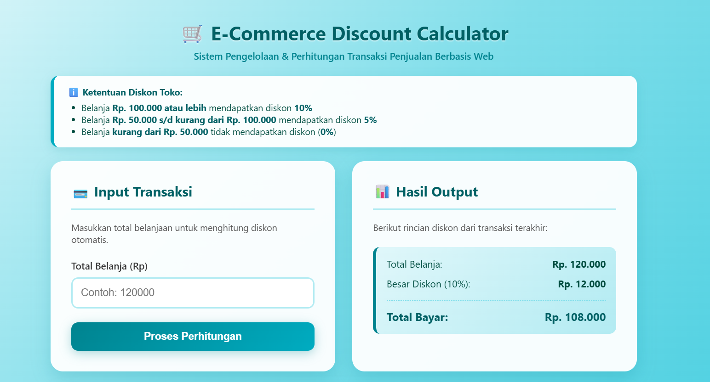

# 🛒 E-Commerce Discount Calculator

## 📌 Fitur Utama
- **Log Riwayat Transaksi**: Menampilkan daftar tabel riwayat transaksi yang pernah dilakukan secara real-time.

## 🖼️ Tampilan Antarmuka (Screenshot)

### 1. Tampilan Awal (Input Transaksi)

### 2. Tampilan Hasil Perhitungan & Riwayat

## 🛠️ Teknologi yang Digunakan
- **PHP** (Server-side Programming)
- **MySQL / XAMPP** (Database)
- **HTML5 & CSS3** (Styling & Layout)

---

## 🔗 Link Repository & Folder Tugas
Kamu bisa mengakses langsung file dan folder kode program ini melalui tautan berikut:
- **Folder Tugas:** [🔗 Lihat Folder Tugas Pertemuan 6-8 di GitHub](https://github.com/univmajalengka/2514101044/tree/main/PAWB/Tugas%20Pertemuan%206-8)