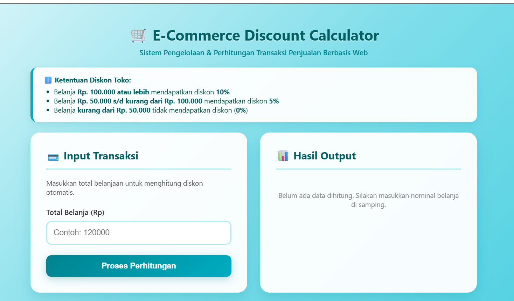

# 🛒 E-Commerce Discount Calculator

Sistem Pengelolaan & Perhitungan Transaksi Penjualan Berbasis Web. Tugas ini dibuat untuk memenuhi tugas mata kuliah Pemrograman Web.

## 📌 Fitur Utama
- **Perhitungan Diskon Otomatis**: Menghitung besaran diskon berdasarkan total belanja (10% untuk belanja $\ge$ Rp 100.000, 5% untuk Rp 50.000 - Rp 99.999, dan 0% untuk di bawah Rp 50.000).
- **Integrasi Database**: Setiap transaksi yang dihitung akan otomatis tersimpan ke dalam database MySQL (XAMPP).
- **Log Riwayat Transaksi**: Menampilkan daftar tabel riwayat transaksi yang pernah dilakukan secara real-time.

## 🖼️ Tampilan Antarmuka (Screenshot)

### 1. Tampilan Awal (Input Transaksi)

### 2. Tampilan Hasil Perhitungan & Riwayat

## 🛠️ Teknologi yang Digunakan
- **PHP** (Server-side Programming)
- **MySQL / XAMPP** (Database)
- **HTML5 & CSS3** (Styling & Layout)